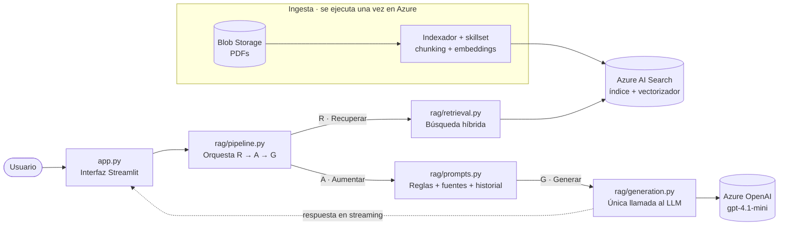

# azure-rag-chat-documents

Chat sobre documentos con **RAG** (Retrieval-Augmented Generation): responde preguntas usando solo el contenido de documentos indexados, citando sus fuentes.

[](https://azure-rag-chat-documents-gmmhjkp5yfqwsdq2zr4izt.streamlit.app)

**Demo:** https://azure-rag-chat-documents-gmmhjkp5yfqwsdq2zr4izt.streamlit.app


**Stack:** Azure AI Search (búsqueda híbrida) · Azure OpenAI (`gpt-4.1-mini` + `text-embedding-3-small`) · Streamlit · Python

## Qué hace la app

- Responde preguntas en lenguaje natural sobre un conjunto de documentos, con la respuesta escrita en tiempo real.
- Cita las fuentes con `[1]`, `[2]`… y muestra el fragmento de cada documento usado, con su score.
- Dice que no tiene la información cuando la pregunta está fuera de los documentos, en lugar de inventar.
- Mantiene el contexto de la conversación para preguntas de seguimiento.
- Permite ajustar cuántos fragmentos recuperar y la temperatura, y muestra los tokens consumidos en la sesión.

### Preguntas para probar

| Pregunta | Qué demuestra |
|---|---|
| What does Contoso Electronics do? | Recuperación básica y cita |
| How much can I expense with PerksPlus? | Dato puntual (USD 1,000) |
| What is the difference between Northwind Health Plus and Standard? | Síntesis entre varios documentos |
| ¿PerksPlus cubre suplementos? | Pregunta en español sobre documentos en inglés |
| How much does a flight to Madrid cost? | No inventa: responde que no tiene la información |

---

## Arquitectura



- **En cada pregunta:** la app busca los fragmentos más relevantes, arma el prompt con ellos y le pide la respuesta al LLM.
- **Ingesta:** se configuró con el asistente *Import and vectorize data* de Azure AI Search, por eso no forma parte del código de la app.

---

## Recorrido de una pregunta

| # | Paso | Qué ocurre | Código |
|---|------|------------|--------|
| 1 | Configuración | Carga el `.env` (local) o los Secrets (Streamlit Cloud) y valida las variables obligatorias. | [`config.py:11`](rag/config.py#L11) · [`config.py:37`](rag/config.py#L37) |
| 2 | Clientes | `@st.cache_resource` crea el pipeline una sola vez por proceso, con un cliente para AI Search y otro para Azure OpenAI. | [`app.py:16`](app.py#L16) · [`pipeline.py:16`](rag/pipeline.py#L16) |
| 3 | Pregunta | `st.chat_input` recibe la pregunta. Los sliders definen cuántos fragmentos recuperar y la temperatura. | [`app.py:75`](app.py#L75) · [`app.py:44`](app.py#L44) |
| 4 | **R · Recuperar** | Búsqueda híbrida: `search_text` (palabras clave) + `VectorizableTextQuery` (significado). Azure AI Search vectoriza la pregunta con el vectorizador del índice, sin pasar por la app. | [`retrieval.py:32`](rag/retrieval.py#L32) |
| 5 | **A · Aumentar** | `build_messages` une el prompt de sistema, los últimos 6 mensajes del historial y los fragmentos numerados `[1]`, `[2]`… con la pregunta. | [`prompts.py:21`](rag/prompts.py#L21) |
| 6 | **G · Generar** | `chat.completions.create` con `stream=True`. El último chunk trae el conteo de tokens. | [`generation.py:18`](rag/generation.py#L18) |
| 7 | Mostrar | `st.write_stream` muestra la respuesta palabra por palabra, y luego las fuentes usadas con su score. | [`app.py:90`](app.py#L90) |

---

## Estructura del proyecto

```
.
├── app.py              # Interfaz Streamlit: solo pantalla, sin lógica de RAG
├── rag/
│   ├── config.py       # Lee y valida variables de entorno
│   ├── clients.py      # Crea los clientes de AI Search y Azure OpenAI
│   ├── retrieval.py    # R: búsqueda híbrida en Azure AI Search
│   ├── prompts.py      # A: system prompt y construcción de mensajes
│   ├── generation.py   # G: llamada al LLM en streaming
│   └── pipeline.py     # Une R → A → G
├── book1.ipynb         # Exploración: RAG de punta a punta en notebook
├── book2.ipynb         # Exploración: comparación de búsqueda por texto, vectorial e híbrida
├── deploy.sh           # Crea la infraestructura en Azure con Azure CLI
└── requirements.txt
```

| Si quieres cambiar… | Edita |
|---|---|
| Cómo se busca (tipo de búsqueda, campos, `k`) | [`rag/retrieval.py`](rag/retrieval.py) |
| Las instrucciones del modelo | [`rag/prompts.py`](rag/prompts.py) |
| El modelo o la versión de la API | Variables de entorno |
| La interfaz | [`app.py`](app.py) |

---

## Recursos en Azure

| Recurso | Configuración | Costo |
|---|---|---|
| Azure OpenAI | S0 | Sin costo fijo |
| `gpt-4.1-mini` | GlobalStandard · 10K tokens/min | Por token |
| `text-embedding-3-small` | GlobalStandard · 10K tokens/min | Por token |
| Azure AI Search | Tier Free | USD 0 |
| Storage Account | Standard_LRS · sin acceso público a blobs | Centavos |
| Hosting | Streamlit Community Cloud | USD 0 |

[`deploy.sh`](deploy.sh) crea todos los recursos con los SKU más económicos.

### Ingesta de documentos

El indexador de Azure AI Search:

1. Lee los PDF del contenedor de Blob Storage.
2. Extrae el texto y lo divide en fragmentos (*chunks*).
3. Genera un embedding por fragmento con `text-embedding-3-small` (1536 dimensiones).
4. Escribe en el índice los campos `chunk`, `title` y `text_vector`.

El indexador es **incremental**: en ejecuciones posteriores solo procesa archivos nuevos o modificados.

---

## Ejecutar localmente

```bash
pip install -r requirements.txt
python -m streamlit run app.py
```

Crea un archivo `.env` en la raíz (está excluido en `.gitignore`):

```env
AZURE_OPENAI_ENDPOINT=https://<tu-recurso>.openai.azure.com/
AZURE_OPENAI_API_KEY=<clave>
AZURE_OPENAI_API_VERSION=2024-10-21
AZURE_OPENAI_CHAT_DEPLOYMENT=gpt-4.1-mini
AZURE_SEARCH_ENDPOINT=https://<tu-servicio>.search.windows.net
AZURE_SEARCH_KEY=<clave>
AZURE_SEARCH_INDEX=<nombre-del-indice>
```

## Despliegue en Streamlit Community Cloud

1. Crea la app desde este repositorio con `app.py` como archivo principal.
2. En **Settings → Secrets** agrega las mismas variables en formato TOML (`CLAVE = "valor"`). Streamlit las expone como variables de entorno, así que el código no cambia.
3. Si cambias un secret, usa **Reboot app**: el pipeline se guarda en caché con la configuración anterior.

Ninguna credencial vive en el repositorio.

---

## Decisiones de diseño

| Decisión | Motivo |
|---|---|
| **Búsqueda híbrida** | Las palabras clave aciertan con términos exactos (nombres de planes o programas); los vectores entienden paráfrasis y preguntas en otro idioma. |
| **`VectorizableTextQuery`** | Search vectoriza la pregunta con el mismo modelo que indexó los fragmentos. Hay una llamada menos y no se pueden desalinear los modelos. |
| **`gpt-4.1-mini`** | Bajo costo y latencia; acepta `temperature` por no ser un modelo de razonamiento. |
| **Temperatura 0.3** | Respuestas fieles al texto de las fuentes. |
| **Prompt de grounding** | Responde solo con las fuentes, cita con `[n]` y dice que no tiene la información cuando la pregunta está fuera de contexto. |
| **Historial de 6 mensajes** | Permite preguntas de seguimiento sin que el prompt crezca sin límite. |
| **Módulos por responsabilidad** | Cada paso (R, A, G) se puede probar y modificar por separado; la interfaz podría reemplazarse por una API sin tocar la lógica. |

**Sobre el score:** en búsqueda híbrida, Azure combina los rankings con *Reciprocal Rank Fusion* (RRF), que produce valores pequeños (≈ 0.01–0.05). Sirve para ordenar resultados; no es un porcentaje de relevancia.

## Hallazgos de las pruebas

- **El contexto limita la respuesta.** Al preguntar por los roles de Recursos Humanos, el catálogo tiene cuatro pero la respuesta dio tres: con 5 fragmentos, el del cuarto rol no entraba en el contexto. Con más fragmentos aparece, a cambio de más tokens.
- **Grounding efectivo.** Ante preguntas ajenas a los documentos, el modelo responde que no tiene la información.
---

## Limitaciones y próximos pasos

- **Seguimientos en la búsqueda:** el LLM recibe el historial, pero la búsqueda usa solo la última pregunta. Siguiente paso: reescribir la consulta con el historial antes de buscar (*query rewriting*).
- **Cobertura vs. costo:** con pocos fragmentos (`top_k`) puede faltar información en respuestas que la tienen repartida en varias partes del documento; con más fragmentos sube el costo en tokens y entra más ruido.
- **Idioma ambiguo:** si la pregunta tiene errores de tipeo, el modelo puede responder en otro idioma. Siguiente paso: definir el español como idioma por defecto en el prompt.
- **Semantic ranker:** requiere AI Search en tier Basic o superior.
- **Para producción:** Managed Identity y Key Vault en lugar de claves, reintentos ante errores 429, evaluación de groundedness y relevancia, observabilidad (trazas y costo por consulta), ingesta automatizada, autenticación de usuarios y despliegue en contenedor con CI/CD.

---

## Datos de ejemplo

La app se probó con los documentos de ejemplo de Microsoft sobre *Contoso Electronics* (manual del empleado, planes de salud Northwind, programa PerksPlus y catálogo de roles). Los PDF no se incluyen en el repositorio; viven en Blob Storage y en el índice de Azure AI Search.

> **Nota:** la demo usa recursos de Azure con créditos limitados, así que podría dejar de responder en algún momento. El código y esta documentación siguen siendo la referencia del proyecto.
